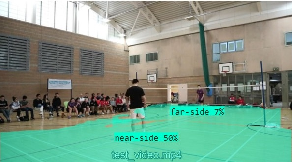
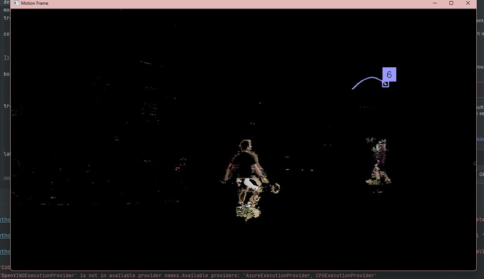
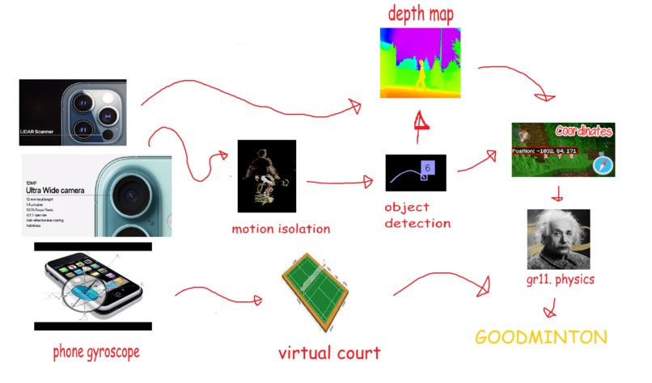
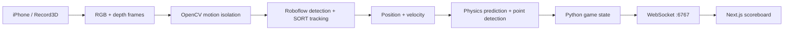
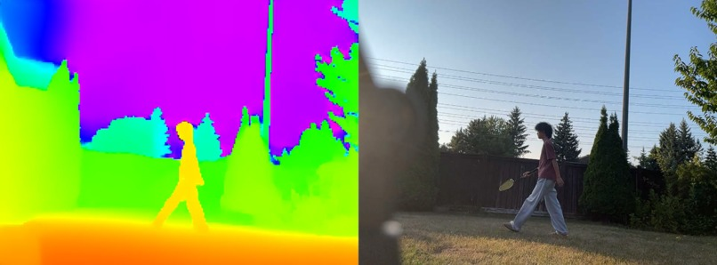
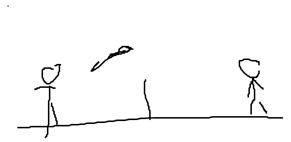

<div align="center">

# Goodminton

### play badminton with an imaginary court and net. imaginary racket not included.

real-time 3D tracking pipeline for fast-moving shuttlecocks occupying as little as 0.024% of a video frame

<div style="display: flex; align-items: center; gap: 20px;">


</div>

[view on Devpost](https://devpost.com/software/goodminton)


</div>

## how it works



Python handles video processing, computer vision (done through Roboflow), physics calculations, and game state (score, court, etc.), which is fed over a WebSocket to Next.js



### capture & detection

- [`backend/streaming.py`](backend/streaming.py) connects to the first Record3D device over USB, reads RGB and depth frames, and retrieves camera intrinsics and pose (TrueDepth frames are mirrored before being returned)
- [`backend/motion.py`](backend/motion.py) compares consecutive grayscale frames, masking out pixels that exceed a certain difference (in this case, 30/255)
- [`backend/main.py`](backend/main.py) adjusts the input for the Roboflow model `badminton-crsqf/1` on the motion image with confidence `0.3`. non-maximum suppression removes overlapping detections; SORT associates detections between frames



### when the birdie disappears

keeping up with a small, fast object every frame isn't always reliable, so [`backend/physics.py`](backend/physics.py) estimates the velocity of the ball when the shuttlecock is lost using simple physics:

```text
velocity = (new_position - previous_position) / elapsed_time
```

when detection drops out, it extrapolates from the last measured position and velocity for up to `0.25` seconds. a gravity-estimating term adds `550 × Z × elapsed_time` to vertical velocity before predicting the next position (this is a heuristic tuned for the demo rather than expressed in metres per second squared)


### game state & frontend
the current point detector checks whether the birdie crosses `Y = 350` in the resized frame, chooses a side using `X = 320`, and waits eight seconds before allowing another point. [`backend/game.py`](backend/game.py) owns the team points, sets, and match settings

`send_coordinates()` broadcasts the last measured coordinates, timestamp, points, sets, and game settings as JSON every `0.1` seconds once a position exists. [`frontend/src/app/page.js`](frontend/src/app/page.js) connects to `ws://localhost:6767`, renders the live data, and retries a closed connection every five seconds. the frontend uses Next.js, React, Tailwind, and Radix UI components



## run it

for the live pipeline, you'll need a Record3D-compatible iPhone with depth capture, the Record3D app streaming over USB, and a desktop session for OpenCV's preview windows (a webcam won't work due to requiring 3D data)

### backend

from the repository root, create a fresh Python environment:

```bash
python3 -m venv .venv
source .venv/bin/activate
python -m pip install -r backend/requirements.txt
python -m pip install record3d inference supervision trackers
```

the final install command adds imports used by the live pipeline that are missing from `requirements.txt`. configure your Roboflow model access if your environment requires it:

```bash
export ROBOFLOW_API_KEY="your-api-key"
cd backend
python main.py
```

start USB streaming in Record3D before launching the backend. device index `0` is selected in `main.py` (change it if multiple devices are connected)

### frontend

in a second terminal, from the repository root (Node.js 20+ recommended):

```bash
cd frontend
npm install
npm run dev
```

open [localhost:3000](http://localhost:3000). Live game data appears after the backend has detected a shuttlecock. Both sides currently assume the browser and backend run on the same computer.

<sup>the repository also includes `test badminton 1.mp4`, `testdepth2.mp4`, and `Output_25 - fixed.mp4` for experiments. the file-input examples in `main.py` are commented out; using them requires switching the capture loop manually.</sup>

